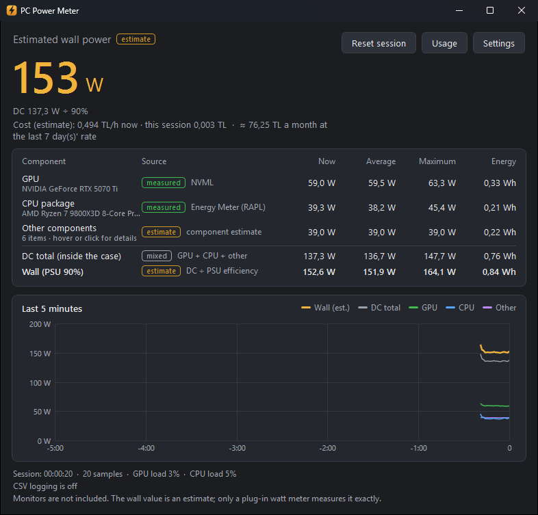
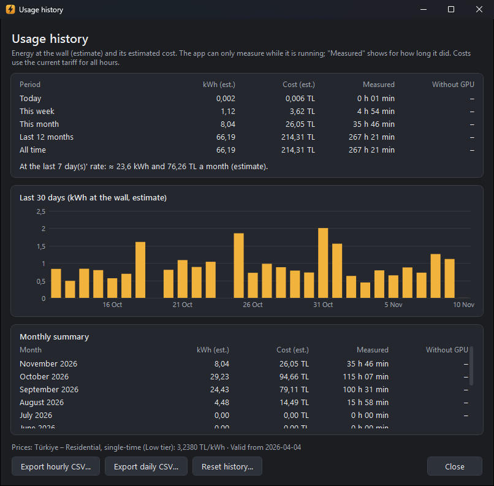

# PC Power Meter

A small Windows app that shows how many watts your PC is drawing right now: GPU, CPU,
the rest of the system and an estimate of the power at the wall socket. It also keeps a
usage history and estimates what that electricity costs.



*Screenshots: live values from a real PC; the usage history behind the monthly estimate is generated sample data.*

- **No drivers.** It installs no kernel driver (no WinRing0, PawnIO or similar), so it is
  friendly to games with anti-cheat software.
- **No administrator rights.** It runs as a normal user and changes no system settings.
- **No telemetry, offline by default.** The app sends nothing about you or your PC
  anywhere. The only network access is the optional tariff update, which is **off by
  default** (see [Network policy](#network-policy)).
- Live chart of the last five minutes, session average / maximum / energy (Wh), optional
  CSV log, notification area icon with the current wattage, English and Turkish UI,
  dark and light theme following Windows.
- **Usage history** (new in 0.2): hourly totals kept on disk; today / this week / this
  month / last 12 months / all time in kWh and estimated cost, a daily chart of the last
  30 days and a monthly summary.
- **Electricity cost** (new in 0.2): cost per hour right now, cost of the session and a
  monthly estimate, from a built-in tariff table (Türkiye, several EU countries) or your
  own price.
- **Component-based estimate** (new in 0.2) for "other components": fans, pump, drives,
  RAM, motherboard, RGB and USB devices, adjustable to your hardware.

## What is measured and what is estimated

| Row | Source | Kind |
|---|---|---|
| GPU | NVIDIA Management Library (`nvml.dll`, part of the NVIDIA driver); `nvidia-smi` as a fallback. Board power of all NVIDIA GPUs. | **Measured** |
| CPU package | Windows Energy Meter performance counter (`Win32_PerfRawData_PowerMeterCounter_EnergyMeter`, the CPU's RAPL package energy counter). Power = energy delta / time delta, using the meter's own timestamps. | **Measured** (value reported by the CPU) |
| CPU package, no counter | `idle + load x (TDP - idle)`, with CPU load from `GetSystemTimes`. TDP and idle power are set in Settings. | **Estimate** |
| Other components | Sum of typical values for your components (see [below](#other-components-estimate)), or a fixed value. | **Estimate** |
| DC total | GPU + CPU + other: the power used inside the case. | Mixed |
| Wall | DC total / PSU efficiency (default 90 %). | **Estimate** |
| Cost | Wall energy x price per kWh of the selected tariff. | **Estimate** |

Every row is labelled *measured*, *estimate* or *unavailable* in the window, together with
its source.

- If the GPU cannot be read, the GPU row says **unavailable** and the totals are marked
  **"GPU NOT included"**. A missing GPU is never counted as 0 W.
- The CPU value is **package power**: cores, I/O die / SoC and cache together. It is higher
  than the "core power" some other tools show.
- Energy (Wh) is accumulated per interval, and each row's session average is its energy
  divided by the time that row covered. The GPU row only covers intervals in which the GPU
  was read. The DC and wall rows cover every interval; in intervals where the GPU could
  not be read they contain no GPU energy, so their average is then too low. The window
  shows this as "N of M intervals without GPU" under those rows, and the CSV has a
  `gpu_included` column per reading.
- After sleep or hibernation (or any interval longer than three sampling intervals and at
  least 5 s) that span is skipped, not counted: the sensors take new baselines and the
  footer shows how many gaps were skipped. Skipped spans are not added to the usage
  history either.

## Other components estimate

Everything in the case except the CPU package and the GPU (motherboard, RAM, drives, fans,
pump, RGB, USB devices) cannot be measured without a driver: motherboard sensors are only
reachable through a kernel driver, and even then boards report voltages, temperatures and
fan speeds, not the total power of the board. So this part is an estimate. In
**Settings > Other components** you enter your hardware; hover over (or click) the
"Other components" row in the main window to see the breakdown.

Typical values used as defaults (DC watts while the PC is in use; every value can be
changed):

| Item | Default | Typical range and reasoning |
|---|---|---|
| Motherboard / chipset | entry 12 W, mainstream 20 W, high-end 30 W | chipset about 5-15 W (two-chip X670E boards at the top), plus onboard LAN, audio, USB controllers and conversion losses |
| RAM module | DDR4 3 W, DDR5 4 W (default 2 x DDR5) | about 2-4 W (DDR4) and 3-5 W (DDR5, with its own PMIC) per module |
| Case fan (incl. radiator fans) | 1.5 W each (default 3) | 120/140 mm fans are rated 1.2-3.6 W at full speed, about 1-2 W at normal speeds |
| CPU cooler | air fan 2 W, AIO pump 4.5 W, none 0 W | pump about 3-6 W; count radiator fans as case fans |
| NVMe SSD | 2 W each (default 1) | 0.05-1 W idle, 3-8 W under load |
| SATA SSD | 1 W each | about 0.3-0.5 W idle, 2-3 W active |
| HDD (3.5") | 6 W each | about 4-6 W idle, 6-9 W active |
| RGB lighting | none 0 W, a little 4 W, a lot 12 W | a few LEDs 3-5 W, many strips and RGB fans 10-15 W |
| USB devices allowance | 2.5 W | keyboard, mouse and a headset together |
| Extra | 0 W | anything else (sound card, capture card, ...) |

The defaults add up to 39 W, close to the fixed 40 W of version 0.1.

**Upgrading from 0.1:** your existing fixed "other components" value is kept exactly as
it was (mode *Fixed value*). Switch to *Estimate from my components* in
Settings > Other components when you want to; the fixed value stays stored, so you can
switch back.

## Usage history

The app adds every measured interval to hourly totals (local time): wall energy, DC
energy, GPU, CPU and other energy, measured time and the part of it without a GPU reading.
An interval that crosses the full hour is split between the two hours. Only hourly totals
are stored, no individual readings.

- File: `%LOCALAPPDATA%\PcPowerMeter\usage-hourly.csv`, a plain CSV file (comma, `.` as
  decimal point, local time). It is written every two minutes, before sleep and on exit.
  Each save writes a new file, forces it to the disk and then swaps it in; the previous
  version is kept as `usage-hourly.csv.bak`. A crash or power cut normally loses only the
  data since the last save (at most about two minutes). If the file is nevertheless found
  empty or unreadable (for example after a power cut while the disk was still writing),
  the app falls back to the `.bak` copy, which can be one save older. Unreadable lines are
  skipped and the original file is kept as `usage-hourly.csv.corrupt-<time>`; the app does
  not crash on a damaged or locked file. Only one instance can run per history file.
- **Usage** button: totals for today, this week, this month, the last 12 months and all
  time, in kWh at the wall and estimated cost; a daily chart of the last 30 days; a monthly
  summary; and "at this rate" monthly estimate from the daily average of the last 7 days
  (today counts only with the part of the day that has passed).
- **The app can only measure while it is running.** The *Measured* column shows how long
  it actually measured; time in which the app was closed or the PC was asleep is not
  included.
- **Export hourly CSV / Export daily CSV** writes the history with costs at the current
  tariff. **Reset history** deletes it after a confirmation. The live CSV log (Settings >
  General) is separate and still available.



*The screenshot uses generated sample usage data.*

## Electricity cost

All costs are estimates: they use the **estimated wall power** and the price of the
selected tariff, with taxes included. With a three-time (time-of-use) tariff every hour of
the history is priced at the period it falls in; the live session cost uses the price at
the time of each reading. Past hours are priced at the tariff that is selected now.

In **Settings > Electricity cost** you choose:

- **Automatic** (default): the first tariff in the table for your Windows region; if there
  is none, no cost is shown.
- A tariff from the table, **My own price** (one price, or day / peak / night prices with
  the limits 06:00 / 17:00 / 22:00, in any currency), or **Off**.
- For a tiered tariff, the **tier**. In Türkiye the tier depends on the whole household's
  consumption (low tier while the household averages at most 8 kWh a day, about 240 kWh a
  month), and the PC is only a part of it, so you choose it from your bill. The default is
  the low tier.

### Tariff table

`data/tariffs.json` in this repository; the app has a built-in copy. Version 1, dated
2026-11-10. Prices are per kWh for households, all taxes included.

**Türkiye**: EPDK Board Decision 14461 (Official Gazette 33214), valid from 4 April 2026;
residential, low voltage, single-term; source:
[EPDK electricity tariffs](https://www.epdk.gov.tr/Detay/Icerik/3-0-1-3/elektriktarifeler).
Price with taxes = (energy + 5 % municipal consumption tax on energy + distribution
242.49 kr/kWh) x 1.10 VAT, rounded to 0.0001 TL:

| Tariff | Energy (kr/kWh) | Price with taxes (TL/kWh) |
|---|---|---|
| Single-time, low tier (household at most 8 kWh/day) | 49.4065 | 3.2380 |
| Single-time, high tier | 189.5808 | 4.8570 |
| Three-time, day 06:00-17:00 | 195.0640 | 4.9204 |
| Three-time, peak 17:00-22:00 | 374.7551 | 6.9958 |
| Three-time, night 22:00-06:00 | 51.3656 | 3.2607 |

Households using more than 4,000 kWh a year (3,000 kWh from 2027) move to the last-resort
supply tariff; that is noted in the table but not used in the calculation.

**EU countries**: national averages from Eurostat
[`nrg_pc_204`](https://ec.europa.eu/eurostat/databrowser/view/nrg_pc_204/default/table)
(household consumers, 2,500-4,999 kWh a year, all taxes and levies included, EUR/kWh),
period **2026-S1** (first half of 2026), retrieved from the Eurostat API on 2026-11-10.
These are country averages, not the price of a specific supplier.

| Country | EUR/kWh | Country | EUR/kWh |
|---|---|---|---|
| Austria | 0.3260 | Italy | 0.3142 |
| Belgium | 0.3575 | Netherlands | 0.2440 |
| Germany | 0.3618 | Poland | 0.2999 (provisional) |
| Spain | 0.2509 | Portugal | 0.2367 |
| France | 0.2485 | Sweden | 0.3062 |
| Ireland | 0.3871 | EU-27 average | 0.2832 |

If your country is not listed, or your contract differs, enter your own price.

## Network policy

- With the default settings the app opens **no network connection at all**.
- The only exception is **Settings > Electricity cost > Update tariffs online**, which is
  **off by default**. When you turn it on, the app downloads
  `https://raw.githubusercontent.com/Zeruh31/pc-power-meter/main/data/tariffs.json` at most
  once a day: a plain GET request without cookies, credentials, identifiers or query
  parameters, with the generic User-Agent `PcPowerMeter/<version>`, a 10-second timeout and
  a 256 KB size limit. The file is checked (schema, unique ids, prices above zero and below
  a per-currency ceiling, time periods covering the day exactly once) and used only if it
  is valid and newer than the table in use; otherwise the app silently keeps the built-in
  or previously downloaded table. The date of the last check and its result are shown in
  Settings.
- Clicking a source link in Settings opens it in your browser; the app itself does not
  fetch it.
- No telemetry, no crash reporting, no update check for the app itself.

## Supported hardware

- **CPU:** processors for which Windows exposes the Energy Meter counter (RAPL package
  energy). This includes Intel CPUs and AMD Ryzen CPUs on current Windows 10/11 builds.
  You can check in Performance Monitor: the counter set "Energy Meter" should list
  `RAPL_Package0_PKG`. Without it the app falls back to the load-based estimate.
- **GPU:** NVIDIA GPUs with the NVIDIA driver installed.
- **Windows:** Windows 10 or 11, 64-bit (x64).

## Limitations

- **The wall value is an estimate.** Software cannot measure wall power; it depends on the
  real PSU efficiency, which varies with load. Use a plug-in watt meter for exact numbers.
  Costs are based on this estimate.
- **Monitors are not included**, nor speakers, routers or anything else on the socket.
- **AMD and Intel GPU power is not read.** Only NVIDIA GPUs report power without a driver;
  on other GPUs the totals exclude the GPU and the app says so.
- **Motherboard power is not read** (it needs a kernel driver, and boards do not report a
  total anyway); "other components" is an estimate.
- The usage history only covers the time the app was running.

## Install and run

1. Download `PcPowerMeter-<version>-win-x64.exe` from the
   [Releases](../../releases) page. It is a single, self-contained file; no .NET install
   is needed. Each release also has a `.sha256` file to verify the download.
2. Run it. There is no installer.

**SmartScreen warning:** the exe is not code-signed, so Windows SmartScreen may show
"Windows protected your PC" on first start. Click **More info**, then **Run anyway**. If
you prefer, build it yourself from source (see below).

Files:

- `%APPDATA%\PcPowerMeter\settings.json`: settings.
- `%LOCALAPPDATA%\PcPowerMeter\usage-hourly.csv`: usage history.
- `%LOCALAPPDATA%\PcPowerMeter\tariffs-cache.json`, `tariffs-update.json`: downloaded tariff
  table and the time of the last check (only if the online update is turned on).
- `%LOCALAPPDATA%\PcPowerMeter\error.log`: details of an unexpected error, if one
  happens (nothing is sent anywhere).

To remove the app, delete the exe and those two folders.

### Notification area

The tray icon shows the current wall estimate when you hover over it. Its menu has
**Show window**, **Reset session** and **Exit**. In Settings you can choose that closing
the window keeps the app running in the notification area.

### Settings

| Setting | Meaning | Default |
|---|---|---|
| Sampling interval | Seconds between readings (0.25 - 60) | 1 |
| PSU efficiency | Used for the wall estimate (50 - 100 %). At low load real PSUs are often less efficient (about 85 %). | 90 % |
| CPU TDP, CPU idle power | Only used when the CPU has no energy counter | 120 W, 25 W |
| Language | System default, English or Turkish | System default |
| CSV log, folder | Write every reading to a CSV file | Off, `Documents\PC Power Meter` |
| Other components | Component estimate or a fixed value | Component estimate (39 W); 0.1 users keep their fixed value |
| Tariff, tier | See [Electricity cost](#electricity-cost) | Automatic by region, low tier |
| Update tariffs online | See [Network policy](#network-policy) | Off |

### Command-line switches

| Switch | Effect |
|---|---|
| `--lang en` / `--lang tr` | Use this language for this run only |
| `--data-dir <folder>` | Keep settings, usage history, tariff cache and error log in this folder instead of `%APPDATA%` / `%LOCALAPPDATA%` (testing, portable use). One instance can run per folder, however it is spelled (trailing `\`, case, relative path). |
| `--no-gpu` | Pretend there is no GPU sensor (to test the "unavailable" path) |
| `--no-cpu-meter` | Ignore the CPU energy counter and use the load-based estimate |

## CSV formats

### Live log

Each session (and each **Reset session**) starts a new file named
`power-log_YYYYMMDD_HHMMSS.csv`. If that name is taken or locked by another program, a
suffix such as `_2` is added; existing files are never overwritten. If writing fails later
(for example the disk is removed), logging stops with a warning and the app keeps running.

The format is the same on every system, whatever the regional settings:

- UTF-8, comma (`,`) as the separator, dot (`.`) as the decimal point, two decimals.
- `timestamp` is local time as `yyyy-MM-dd HH:mm:ss`.
- An empty field means the value was not available (for example no GPU).

Columns: `timestamp, elapsed_s, gpu_w, gpu_load_pct, gpu_source, cpu_w, cpu_load_pct,
cpu_source, other_w_est, dc_w, wall_w_est, psu_efficiency, gpu_included`.

### Usage exports

Same conventions. Hourly: `hour, wall_kwh_est, dc_kwh, gpu_kwh, cpu_kwh, other_kwh_est,
measured_h, no_gpu_h, price_per_kwh, cost_est, currency`. Daily: `date, wall_kwh_est,
dc_kwh, gpu_kwh, cpu_kwh, other_kwh_est, measured_h, no_gpu_h, cost_est, currency`. Price
and cost are empty when no price is set.

**Excel note:** in regions that use a comma as the decimal separator (for example Turkish
or German), double-clicking the file may put everything in one column or read `12.50` as a
date or a whole number. Use **Data > From Text/CSV**, choose **Comma** as the delimiter and
set **File Origin / Locale** to *English (United States)*, or open it in LibreOffice and
pick the same options.

## Build from source

Requirements: Windows, [.NET 8 SDK](https://dotnet.microsoft.com/download/dotnet/8.0).

```
dotnet build PcPowerMeter.sln
dotnet test PcPowerMeter.sln
dotnet run --project src/PcPowerMeter
```

Single-file, self-contained exe (as on the Releases page):

```
dotnet publish src/PcPowerMeter/PcPowerMeter.csproj -c Release -r win-x64 --self-contained -p:PublishSingleFile=true -o publish
```

Repository layout:

- `src/PcPowerMeter.Core` - platform-independent calculations (energy deltas, statistics,
  CSV format, settings, usage history, tariffs and prices, component estimate); covered by
  the tests.
- `src/PcPowerMeter` - the WPF app: sensors (NVML, nvidia-smi, Energy Meter, CPU times),
  UI, tray icon.
- `data/tariffs.json` - the tariff table (built into the app and used by the optional
  online update).
- `tests/PcPowerMeter.Tests` - xUnit tests.
- `tools/make-icon.ps1` - regenerates the app icon.

The only NuGet package the app uses is `System.Management` (MIT, from Microsoft) for WMI.
The usage history is a plain text file, so no database library is needed.

Pushing a tag such as `v1.0.0` runs `.github/workflows/release.yml`, which builds the exe
and attaches it to a GitHub release.

## License

[MIT](LICENSE). Copyright (c) 2026 Zeruh31.

---

## Türkçe

Bilgisayarın o anda kaç watt çektiğini gösteren küçük bir Windows uygulaması: GPU, CPU,
sistemin geri kalanı ve prizden çekilen gücün tahmini. Kullanım geçmişini de tutar ve bu
elektriğin maliyetini tahmin eder.

- **Sürücü kurmaz.** Hiçbir çekirdek sürücüsü yüklemez (WinRing0, PawnIO vb. yok); bu
  yüzden hile önleme (anti-cheat) yazılımı olan oyunlarla sorun çıkarmaz.
- **Yönetici yetkisi istemez**, sistem ayarlarını değiştirmez.
- **Telemetri yok, varsayılan olarak çevrimdışı.** Sizinle ya da bilgisayarınızla ilgili
  hiçbir şey gönderilmez. Tek ağ erişimi, **varsayılan olarak kapalı** olan isteğe bağlı
  tarife güncellemesidir (aşağıda "Ağ politikası").
- Son beş dakikanın canlı grafiği, oturum ortalaması / en yüksek değer / toplam enerji
  (Wh), isteğe bağlı CSV kaydı, bildirim alanında anlık watt, Türkçe ve İngilizce arayüz,
  Windows'a uyan koyu ve açık tema.
- **Kullanım geçmişi** (0.2'de yeni): saatlik toplamlar diskte tutulur; bugün / bu hafta /
  bu ay / son 12 ay / tüm zamanlar için kWh ve tahmini maliyet, son 30 günün günlük
  grafiği ve aylık özet.
- **Elektrik maliyeti** (0.2'de yeni): şu anki saatlik maliyet, oturum maliyeti ve aylık
  tahmin; gömülü tarife tablosundan (Türkiye, birkaç AB ülkesi) ya da kendi fiyatınızla.
- **Bileşen tabanlı "diğer bileşenler" tahmini** (0.2'de yeni): fanlar, pompa, diskler,
  RAM, anakart, RGB ve USB cihazları; kendi donanımınıza göre ayarlanır.

### Ne ölçülüyor, ne tahmin

| Satır | Kaynak | Tür |
|---|---|---|
| GPU | NVIDIA sürücüsüyle gelen NVML (`nvml.dll`); yedek olarak `nvidia-smi`. Kartın toplam gücü. | **Ölçüm** |
| CPU paketi | Windows'un yerleşik Enerji Ölçer sayacı (işlemcinin RAPL paket enerji sayacı). Güç = enerji farkı / zaman farkı. | **Ölçüm** (işlemcinin bildirdiği değer) |
| CPU paketi, sayaç yoksa | `boşta + yük x (TDP - boşta)`; TDP ve boşta güç Ayarlar'dan girilir. | **Tahmin** |
| Diğer bileşenler | Bileşenlerinizin tipik değerlerinin toplamı ya da sabit bir değer. | **Tahmin** |
| Toplam DC | GPU + CPU + diğer: kasanın içinde harcanan güç. | Karışık |
| Duvar | Toplam DC / PSU verimi (varsayılan %90). | **Tahmin** |
| Maliyet | Duvar enerjisi x seçilen tarifenin kWh fiyatı. | **Tahmin** |

- GPU okunamazsa GPU satırında **kullanılamıyor** yazar ve toplamlar **"GPU HARİÇ"** diye
  işaretlenir; eksik GPU asla 0 W sayılmaz.
- CPU değeri **paket gücüdür** (çekirdekler + IO/SoC + önbellek); bazı programlarda görülen
  "çekirdek gücü"nden yüksektir.
- GPU'nun okunamadığı aralıklar toplam DC ve duvar satırlarına GPU enerjisi olmadan girer;
  pencere bunu bu satırların altında "M aralığın N tanesinde GPU yok" diye gösterir.
- Uyku/hazırda bekleme sonrası (ya da üç ölçüm aralığından ve 5 sn'den uzun bir aralıkta) o
  süre sayılmaz; sensörler yeniden başlangıç alır. Bu süre kullanım geçmişine de eklenmez.

### Diğer bileşenler tahmini

CPU paketi ve GPU dışındaki her şey (anakart, RAM, diskler, fanlar, pompa, RGB, USB
cihazları) sürücü olmadan ölçülemez: anakart sensörlerine yalnız çekirdek sürücüsüyle
erişilebilir ve anakartlar zaten toplam güç değil, gerilim, sıcaklık ve fan hızı bildirir.
Bu yüzden bu kısım tahmindir. **Ayarlar > Diğer bileşenler**'den donanımınızı girin; ana
penceredeki "Diğer bileşenler" satırının üzerine gelince (ya da tıklayınca) döküm görünür.

Varsayılan tipik değerler (bilgisayar kullanılırken DC watt; hepsi değiştirilebilir):
anakart / yonga seti giriş 12 W, orta 20 W, üst 30 W; RAM modülü DDR4 3 W, DDR5 4 W
(varsayılan 2 x DDR5); kasa fanı (radyatör fanları dahil) adet başına 1,5 W (varsayılan 3);
CPU soğutucu hava fanı 2 W, AIO pompa 4,5 W; NVMe SSD 2 W (varsayılan 1); SATA SSD 1 W;
3,5" HDD 6 W; RGB az 4 W, çok 12 W; USB cihazları payı 2,5 W; ek 0 W. Gerekçeler yukarıdaki
İngilizce tabloda. Varsayılanların toplamı 39 W'tır (0.1'deki sabit 40 W'a yakın).

**0.1'den yükseltenler:** mevcut sabit "diğer bileşenler" değeriniz aynen korunur (mod:
*Sabit değer*). İsterseniz Ayarlar > Diğer bileşenler'den *Bileşenlerimden tahmin et*'e
geçebilirsiniz; sabit değer saklı kalır, geri dönebilirsiniz.

### Kullanım geçmişi

Her ölçüm aralığı yerel saate göre saatlik toplamlara eklenir (duvar, DC, GPU, CPU, diğer
enerji, ölçülen süre ve GPU'suz süre). Saat başını aşan bir aralık iki saate bölünür.
Yalnız saatlik toplamlar saklanır, tek tek okumalar saklanmaz.

- Dosya: `%LOCALAPPDATA%\PcPowerMeter\usage-hourly.csv` (düz CSV). İki dakikada bir, uykudan
  önce ve kapanışta yazılır. Her kayıtta yeni dosya yazılır, diske zorlanır ve sonra
  eskisinin yerine geçer; önceki sürüm `usage-hourly.csv.bak` olarak saklanır. Çökme ya da
  elektrik kesintisinde normalde yalnız son kayıttan sonraki veri (en fazla yaklaşık iki
  dakika) kaybolur. Dosya yine de boş ya da okunamaz bulunursa (ör. disk yazarken kesinti)
  uygulama bir kayıt daha eski olabilen `.bak` kopyasına döner. Okunamayan satırlar atlanır,
  asıl dosya `usage-hourly.csv.corrupt-<zaman>` olarak saklanır; bozuk ya da kilitli dosya
  uygulamayı çökertmez. Aynı geçmiş dosyası için tek bir örnek çalışabilir.
- **Kullanım** düğmesi: bugün, bu hafta, bu ay, son 12 ay ve tüm zamanlar için duvarda kWh
  ve tahmini maliyet; son 30 günün günlük grafiği; aylık özet; son 7 günün günlük
  ortalamasından "bu hızla aylık" tahmin (bugün yalnız geçen kısmıyla sayılır).
- **Uygulama yalnız açıkken ölçebilir.** *Ölçülen süre* sütunu gerçekten ne kadar
  ölçüldüğünü gösterir; uygulamanın kapalı ya da bilgisayarın uykuda olduğu süre dahil
  değildir.
- **Saatlik / Günlük CSV dışa aktar** geçmişi şu anki tarifeyle hesaplanmış maliyetlerle
  yazar. **Geçmişi sıfırla** onay sonrası siler. Canlı CSV kaydı ayrıdır ve duruyor.

### Elektrik maliyeti

Tüm maliyetler tahminidir: **tahmini duvar gücü** ve seçilen tarifenin vergiler dahil
fiyatı kullanılır. Üç zamanlı tarifede geçmişteki her saat kendi dilimine göre
fiyatlanır. Geçmiş saatler de şu an seçili tarifeyle hesaplanır.

**Ayarlar > Elektrik maliyeti**'nden: **Otomatik** (varsayılan; Windows bölgenizin
tablodaki ilk tarifesi, yoksa maliyet gösterilmez), tablodan bir tarife, **Kendi fiyatım**
(tek fiyat ya da 06:00 / 17:00 / 22:00 sınırlarıyla gündüz / puant / gece, herhangi bir para
biriminde) ya da **Kapalı**. Tek zamanlı Türkiye tarifesinde **kademeyi siz seçersiniz**:
kademe bilgisayarın değil tüm hanenin tüketimine bağlıdır (hanenin günlük ortalaması en
fazla 8 kWh, yani ayda yaklaşık 240 kWh iken düşük kademe); faturanıza bakın. Varsayılan
düşük kademedir.

**Türkiye fiyatları** (EPDK Kurul Kararı 14461, Resmî Gazete 33214, 4 Nisan 2026'dan beri;
mesken, AG, tek terimli; kaynak:
[EPDK elektrik tarifeleri](https://www.epdk.gov.tr/Detay/Icerik/3-0-1-3/elektriktarifeler)).
Vergiler dahil fiyat = (enerji + enerjinin %5'i BTV + dağıtım 242,49 kr/kWh) x 1,10 KDV,
0,0001 TL'ye yuvarlanmış: tek zamanlı düşük kademe **3,2380 TL/kWh**, yüksek kademe
**4,8570 TL/kWh**; üç zamanlı gündüz (06-17) **4,9204**, puant (17-22) **6,9958**, gece
(22-06) **3,2607 TL/kWh**. Yılda 4.000 kWh'yi (2027'den itibaren 3.000 kWh) aşan meskenler
son kaynak tedarik tarifesine geçer; bu tabloda not olarak var, hesaba katılmaz.

**AB ülkeleri:** Eurostat `nrg_pc_204` ülke ortalamaları (hane, yıllık 2.500-4.999 kWh,
tüm vergiler dahil, EUR/kWh), dönem **2026-S1**, Eurostat API'sinden 2026-11-10'da alındı.
Belirli bir tedarikçinin fiyatı değildir. Ülkeniz yoksa ya da sözleşmeniz farklıysa kendi
fiyatınızı girin.

### Ağ politikası

- Varsayılan ayarlarla uygulama **hiçbir ağ bağlantısı açmaz**.
- Tek istisna, **varsayılan olarak kapalı** olan **Ayarlar > Elektrik maliyeti > Tarifeleri
  çevrimiçi güncelle** seçeneğidir. Açarsanız uygulama
  `https://raw.githubusercontent.com/Zeruh31/pc-power-meter/main/data/tariffs.json`
  dosyasını günde en fazla bir kez indirir: çerez, kimlik bilgisi, tanımlayıcı ya da sorgu
  parametresi olmayan düz bir GET isteği; genel User-Agent `PcPowerMeter/<sürüm>`; 10 sn
  zaman aşımı; 256 KB boyut sınırı. Dosya doğrulanır (şema, benzersiz kimlikler, sıfırın
  üstünde ve para birimine göre bir tavanın altında fiyatlar, günü tam bir kez kapsayan
  zaman dilimleri) ve yalnız geçerli ve kullanılandan yeniyse kullanılır; aksi halde
  uygulama sessizce gömülü ya da önceden indirilmiş tabloyla devam eder. Son kontrol
  zamanı ve sonucu Ayarlar'da görünür.
- Ayarlar'daki kaynak bağlantısına tıklamak sayfayı tarayıcınızda açar; uygulama o
  sayfayı kendisi indirmez.

### Desteklenen donanım ve sınırlamalar

- **CPU:** Windows'un Enerji Ölçer sayacını sunduğu işlemciler (Intel ve güncel Windows
  10/11'de AMD Ryzen). Sayaç yoksa yükten tahmin edilir ve bu ekranda yazılır.
- **GPU:** sürücüsü kurulu NVIDIA kartlar. **AMD ve Intel GPU gücü okunmaz**; bu durumda
  toplamlar GPU hariçtir ve uygulama bunu açıkça gösterir.
- **Anakart gücü okunmaz** (çekirdek sürücüsü gerekir, anakartlar zaten toplam güç
  bildirmez); "diğer bileşenler" tahmindir.
- **Duvar değeri ve maliyet tahmindir.** Kesin değer için prize takılan bir watt-metre
  gerekir.
- **Monitörler dahil değildir.** Kullanım geçmişi yalnız uygulamanın açık olduğu süreyi
  kapsar.

### Kurulum ve çalıştırma

[Releases](../../releases) sayfasından `PcPowerMeter-<sürüm>-win-x64.exe` dosyasını indirip
çalıştırın; kurulum ve .NET gerekmez. Exe imzasız olduğu için ilk açılışta Windows
SmartScreen "Windows bilgisayarınızı korudu" uyarısı verebilir: **Ek bilgi** ve ardından
**Yine de çalıştır**'a tıklayın. İsterseniz kaynak koddan kendiniz derleyebilirsiniz
(yukarıdaki "Build from source" bölümü).

Ayarlar `%APPDATA%\PcPowerMeter\settings.json`, kullanım geçmişi
`%LOCALAPPDATA%\PcPowerMeter\usage-hourly.csv` dosyasında tutulur; beklenmeyen bir hata
olursa ayrıntılar `%LOCALAPPDATA%\PcPowerMeter\error.log` dosyasına yazılır (hiçbir yere
gönderilmez). `--data-dir <klasör>` ile hepsi tek bir klasörde tutulabilir.

### CSV kaydı ve Excel

CSV dosyaları her sistemde aynı biçimdedir: virgül ayraç, nokta ondalık işareti, UTF-8.
Kayıt dosyası başka bir programda (ör. Excel'de) açık ya da kilitliyse uygulama çökmez,
yeni bir dosya adı kullanır. Türkçe Excel'de dosyaya çift tıklamak sütunları karıştırabilir;
**Veri > Metinden/CSV'den** ile açıp ayırıcı olarak **Virgül**, dosya kaynağı / yerel ayar
olarak **İngilizce (ABD)** seçin.

### Lisans

[MIT](LICENSE). Copyright (c) 2026 Zeruh31.
